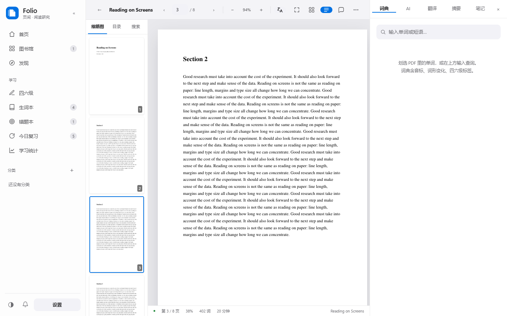
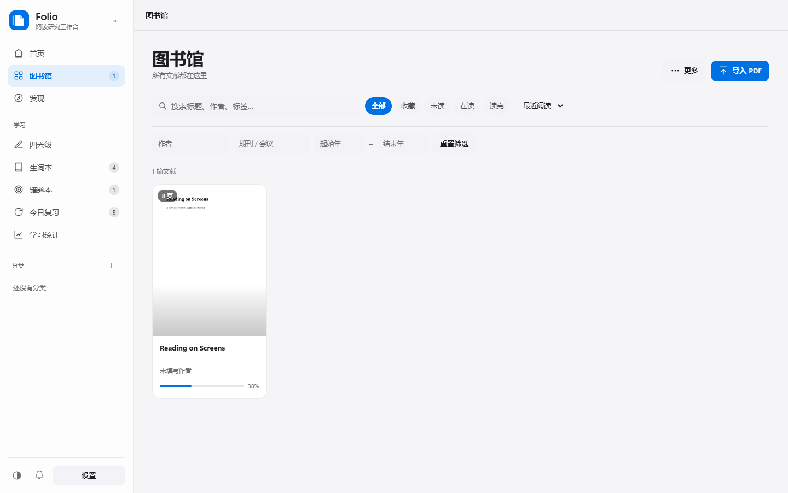
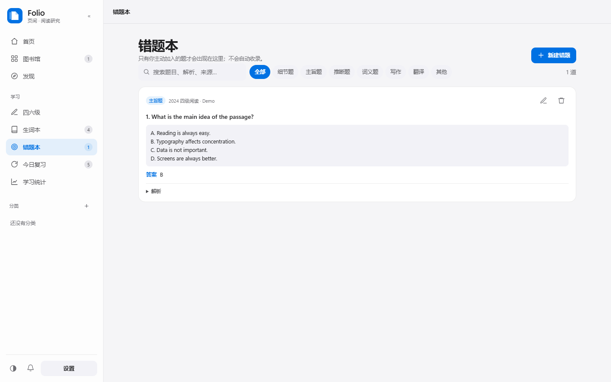

# Folio

**本地优先的英文阅读、四六级学习与科研工作台。**  
**A local-first Windows workbench for English reading, CET-4/6 study and research.**

[](LICENSE)
[](https://github.com/bw448/folio/releases/latest)
[](requirements.txt)
[](#数据与隐私)

Folio 是一个本地优先的桌面阅读与研究工作台：读英文论文、备考四六级、整理科研资料。  
它把 PDF/EPUB 阅读、离线词典、AI 讲解、间隔重复、题目解析、手动错题本、文献发现和 WebDAV 同步放在一个软件里。所有数据保存在第一次启动时选择的资料库文件夹中，不上传遥测。

Folio is a local-first desktop workbench for reading English papers, preparing for CET-4/6, and organizing research. It combines a PDF/EPUB reader, offline dictionary, AI explanations, spaced repetition, question analysis, a manual wrong-answer notebook, literature discovery and optional WebDAV sync. Your data stays in a library folder you choose on first launch; there is no telemetry.

---

## 界面预览 / Screenshots

| 首页 / Home | 阅读器 / Reader |
| --- | --- |
|  |  |

| 图书馆 / Library | 错题本 / Mistakes |
| --- | --- |
|  |  |

---

## 适合谁 / Who it is for

- 需要读英文论文、英文教材、英文报道的人
- 备考四六级，想做真题精读、词汇积累、题目解析和错题复盘的人
- 想在一个软件里完成「读文献 → 查词 → 做笔记 → 复习 → 整理科研材料」的人
- 希望数据留在本机、不想把笔记和 PDF 上传到云端的人

---

## 主要功能 / Features

### 阅读 / Reading

- **拖入导入**：在首页、图书馆、四六级或阅读器任意位置把 PDF / EPUB 拖进窗口即可
- **PDF / EPUB 阅读器**：页面渲染、文字层划词、缩略图、目录、全文搜索、阅读进度
- **EPUB 重排**：导入时自动排成 480×720 的屏幕版 PDF，默认 15pt，保留章节目录；支持 13/15/17/19pt 重新排版
- **扫描版 OCR**：RapidOCR 离线识别，识别后可划词、搜索、翻译、总结
- **网页导入**：粘贴 URL，trafilatura 提取正文并生成可读 PDF
- **双语对照**：按页保存原文/译文段落；可导出「左原页 + 右译文」的双语 PDF
- **五色高亮、备注、页内笔记**：高亮进入 FSRS 复习队列
- **专注阅读**：`F` 隐藏侧栏和缩略图栏

### 学习 / Study

- **划词自动查词**：选中单词或短语，直接弹出音标、释义、发音、AI 详解、加入生词本（可在设置关闭）
- **整词选中与自动复制**：拖动选择会吸附到完整单词；选中后自动复制到剪贴板（可在设置关闭）
- **ECDICT 离线词典**：77 万词条，含音标、中英释义、词形变化、四六级/考研/托福/雅思标签
- **题目解析**：粘贴题干 + A–D 选项，AI 判断题型、给答案、逐项解释、标同义替换和定位句
- **四六级 PDF**：四六级页 →「导入四六级 PDF」，或在图书馆「更多 → 导入四六级 PDF」；PDF 会归入四六级资料
- **归类/筛选**：图书馆可按「四六级」筛选；打开文献 → 更多 →「标记为四六级/取消」；没有题目的阅读也可以放进来
- **阅读器里解题**：在试卷 PDF 中框选一道题（含选项），选择菜单会出现「解题」
- **错题本（手动）**：只有你点「加入错题本」的题才会保存；支持答案、题型、来源、解析、搜索、筛选、编辑
- **生词本 + FSRS**：单词/短语按遗忘曲线复习；高亮也能复习
- **四六级精读**：粘贴真题/外刊，自动标 CET-4 / CET-6 核心词
- **写作批改**：按 15 分制给分，逐句修改，再给一篇升级版范文
- **学习统计与年度报告**：阅读时长、生词、复习、高亮、笔记、热力图

### 科研 / Research

- **AI 论文问答**：只基于检索到的页面回答，回答带 `[p.页码]` 引用
- **结构化摘要**：TL;DR、研究问题、方法、数据、结果、贡献、局限、关键术语
- **研究工具**：速读卡、方法拆解、审稿人视角、相关工作段落、研究空白、精读笔记
- **多篇文献对比**：2–6 篇论文的研究问题/方法/数据/结果/创新/局限对比表
- **文献发现**：arXiv、OpenAlex、Crossref、Semantic Scholar、PubMed；Unpaywall 补开放 PDF
- **AI 研究员**：规划检索式 → 跨库抓取 → 去重排序 → 中文研究简报
- **关注主题**：每日检查新论文，侧栏通知
- **Zotero 导入**：本地 API、CSL JSON、BibTeX
- **导出**：Obsidian、Notion、Logseq、完整 Markdown、BibTeX、RIS、Anki `.apkg`

### 数据 / Data

- **WebDAV 跨设备同步**：文献、PDF/EPUB、生词、高亮、笔记、主题、文章
- **删除/内容冲突中心**：逐字段显示本机/云端差异，选择保留哪一侧
- **资料库位置可选**：第一次启动必须选择；之后可在设置里更改
- **原生桌面窗口**：WebView2 内嵌窗口，没有浏览器标签、地址栏或控制台窗口
- **本地优先**：服务只监听 `127.0.0.1:8788`，没有账号系统，不上传遥测

---

## 下载使用 / Install

到 [Releases](https://github.com/bw448/folio/releases/latest) 下载：

```
Folio-0.9-win64.zip   (约 223 MB)
```

1. 解压得到 `Folio/` 文件夹
2. 双击 `Folio.exe`
3. 第一次启动选择一个**资料库文件夹**（数据库、PDF/EPUB、导出、词典都放这里）
4. 需要 AI 功能时，在「设置」里填 DeepSeek / OpenAI / 本地 Ollama

`Folio.exe` 不能单独拷走，必须和 `_internal/` 一起使用。

> 需要 Windows 10/11。界面使用系统 WebView2 Runtime；Windows 11 默认自带，Win10 可通过 Edge 更新安装。

> 未签名 exe，Windows SmartScreen 可能提示：更多信息 → 仍要运行。

### 需要联网的功能 / Online features

AI 对话/翻译/摘要/解题/研究工具、文献发现、网页导入、WebDAV 同步。

词典、阅读、标注、生词、错题、复习、统计、OCR 完全离线。

---

## 从源码运行 / Run from source

要求：Windows、Python 3.11+。

```bat
git clone https://github.com/bw448/folio.git
cd folio
python -m venv .venv
.venv\Scripts\pip install -r requirements.txt
```

准备离线词典（仓库不包含 63MB CSV / 98MB SQLite）：

1. 从 [ECDICT](https://github.com/skywind3000/ECDICT) 下载 `ecdict.csv`
2. 放到 `data/ecdict.csv`
3. 运行：

```bat
.venv\Scripts\python.exe build_dict.py
```

启动：

```bat
start.bat
```

或手动：

```bat
.venv\Scripts\python.exe -m uvicorn server:app --app-dir . --host 127.0.0.1 --port 8788
```

然后打开 `http://127.0.0.1:8788`。

---

## 打包 Windows exe / Build

```bat
.venv\Scripts\pip install pyinstaller
build_exe.bat
```

输出：

```
dist\Folio\Folio.exe
dist\Folio\_internal\
```

用的是 PyInstaller **onedir**，不是 onefile。原因：这个项目依赖 PyMuPDF、RapidOCR/ONNX、ECDICT，onedir 启动快、杀毒误报少、更新和排查都更简单。

Release 把整个 `dist\Folio\` 压成 `Folio-0.9-win64.zip` 上传即可。

---

## 数据与隐私 / Data & privacy

- 原生窗口使用 Windows WebView2 渲染；本地服务只监听 `127.0.0.1:8788`，不经过浏览器
- 没有账号系统，没有遥测，没有云端用户数据库
- 第一次启动必须选择资料库文件夹；`storage.json` 只记录这个本地路径
- API Key / WebDAV 密码保存在本机数据库里，不写入源码
- AI 请求会把选中的文本发给**你自己配置的** AI 服务商
- WebDAV 同步只连**你自己填的**网盘
- 错题本目前随本地数据库保存，暂未进入 WebDAV 同步

资料库结构：

```
readmate.db    文献、生词、标注、笔记、错题、设置
pdfs/          导入的 PDF / EPUB；EPUB 同时保留原文件和屏幕版 PDF
cache/         页面与封面缓存
exports/       导出的文件
ecdict.db      离线词典
```

换电脑：复制整个资料库文件夹，在新电脑第一次启动时选择它。

---

## 技术栈 / Stack

- **后端**：FastAPI + Uvicorn + SQLite
- **PDF / EPUB**：PyMuPDF
- **OCR**：RapidOCR + ONNX Runtime
- **词典**：ECDICT
- **间隔重复**：FSRS
- **Anki 导出**：genanki
- **网页正文**：trafilatura
- **AI**：任意 OpenAI 兼容接口（DeepSeek / OpenAI / Ollama）
- **前端**：原生 HTML / CSS / JavaScript，无构建步骤

---

## 项目结构 / Layout

```
folio/
├─ server.py            FastAPI 后端：文献、阅读、词典、AI、复习、同步、存储
├─ launcher.py          exe 启动器
├─ static/              原生前端
│  ├─ index.html
│  ├─ style.css
│  └─ app.js
├─ build_dict.py        ECDICT CSV → SQLite
├─ requirements.txt
├─ Folio.spec           PyInstaller 配置
├─ build_exe.bat
├─ start.bat
├─ docs/                README 截图
├─ LICENSE              AGPL-3.0
└─ THIRD_PARTY_NOTICES.md
```

---

## 已知限制 / Limitations

- **PyMuPDF** 是 AGPL-3.0；开源分发需遵守 AGPL，商业用途需商业许可
- **EPUB** 重排对复杂版式、漫画、固定版式不完美；重新排版会改变页码，已有高亮/笔记仍按旧页码保存
- **OCR** 对公式、竖排、复杂排版不完美
- **双语 PDF** 是左右对照，不是原位替换
- **Semantic Scholar** 未填 API Key 时容易限流
- **Zotero** 需要开启「允许其他应用通信」，只读
- **WebDAV** 只支持 Basic Auth
- **错题本** 暂未进入 WebDAV 同步
- 不含四六级听力/口语模块

---

## 许可证 / License

本项目以 **GNU Affero General Public License v3.0（AGPL-3.0）** 发布。  
Copyright (C) 2026 bw448.

选择 AGPL 的直接原因：项目依赖 **PyMuPDF**，它是 AGPL-3.0 或商业许可。  
如果你要在 MIT / Apache-2.0 项目里复用本代码，需要先处理 PyMuPDF 的许可。

第三方依赖与数据来源见 [THIRD_PARTY_NOTICES.md](THIRD_PARTY_NOTICES.md)。

---

## 参与 / Contributing

- 发现问题：开 Issue，附上系统版本、复现步骤、相关日志
- 想改代码：先开 Issue 说明方向，再提 PR
- 不需要 star、不需要赞助；能帮到你的阅读和科研就够了

---

## 常见问题 / FAQ

**窗口打不开？** 查看 `%LOCALAPPDATA%\Folio\desktop.log`；端口被占用时关掉占用 `8788` 的程序。

**AI 报 400？** 设置里填 Key，点「测试连接」。Ollama 用 `http://127.0.0.1:11434/v1`。

**词典 503？** 源码运行需要先下载 ECDICT CSV 并运行 `build_dict.py`；Release zip 已内置词典 seed。

**扫描版不能划词？** 点顶部「运行 OCR」。

**导入 EPUB 后页码变了？** EPUB 会按字号重新分页；在「更多 → EPUB 排版」里调整。

**想备份/换电脑？** 退出程序，复制整个资料库文件夹。
